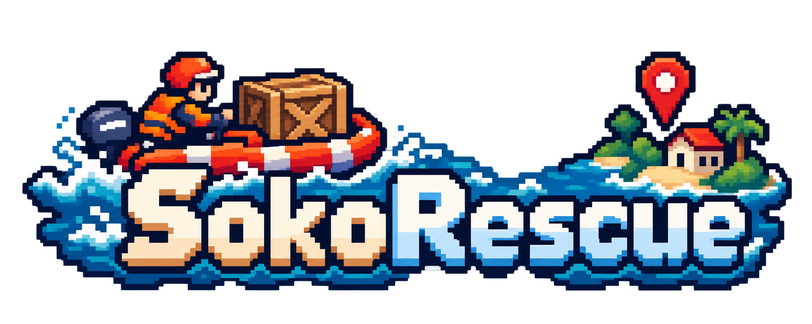
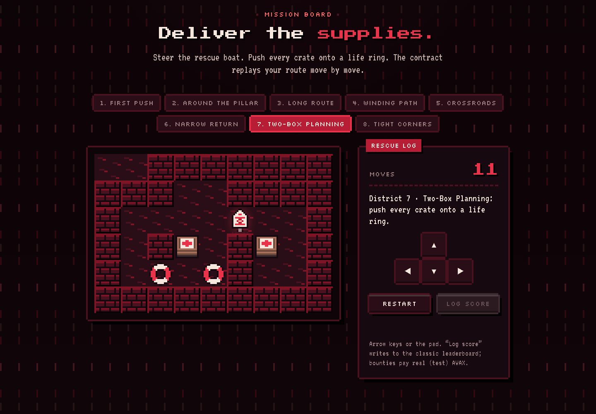

**English** | [ภาษาไทย (Thai version)](README.th.md)

<p align="center">
  
</p>

# SokoRescue

A flood-rescue puzzle game where every move matters. Steer the rescue boat, push food supplies through flooded streets, and deliver them to the marked rescue points — then put AVAX on a puzzle and let the contract pay whoever solves it first.

SokoRescue was built at [Team1 Thailand — Codebase Hackathon: Chula Edition](https://build.avax.network/events/b6bc9762-afc9-416d-b21e-9795750663d1) and won the **Gaming Track**.

**[Play on Vercel →](https://sokorescue.vercel.app/)**



## How does it work?

SokoRescue is a skill-based Sokoban game with eight missions. Pick a level, plan your route, and push every food crate onto a rescue point without trapping it.

Once a mission is complete, the game sends your move sequence to the `SokoChain` smart contract. The contract replays every move, checks that the solution is valid, and saves your best score for that level. The browser cannot simply claim a high score — the puzzle solution itself is verified on-chain.

On top of the leaderboard, **Puzzle Bounties** turn any map into a prize: lock AVAX on it, and the first player to prove a valid route is paid directly by the contract.

## Networks

Pick the network from the selector in the top bar (or open the site with `?network=fuji` / `?network=mainnet`).

| Network | Chain ID | `SokoChain` contract |
| --- | ---: | --- |
| Avalanche Fuji (testnet) | 43113 | [`0x550389FA1204B5C4968d6C4942D4F3996940217f`](https://testnet.snowtrace.io/address/0x550389FA1204B5C4968d6C4942D4F3996940217f) |
| Avalanche C-Chain (mainnet) | 43114 | [`0x1048715d77C9532E2Ed631D09859e090cB23d01D`](https://snowtrace.io/address/0x1048715d77C9532E2Ed631D09859e090cB23d01D) |

> **Mainnet uses real AVAX.** The contract is unaudited. Try everything on Fuji first.
>
> **Known limitation:** the first valid reveal wins. Anyone who already knows a solution — including the bounty creator using a second wallet — can race your reveal and get theirs mined first. Keep mainnet rewards small.

## How to play

### 1. Pick a mission

Start with **First Push**, or jump straight into any of the eight levels. The later missions add tighter routes and multi-crate planning.

### 2. Deliver the supplies

Use the arrow keys or the on-screen controls to move the rescue boat. Push every food crate onto a GPS rescue marker. You can restart the mission whenever a crate gets stuck.

### 3. Save your score

Connect Core Wallet and choose Fuji or C-Chain. After solving a mission, confirm one transaction to submit the full move sequence. Your personal best and the level's world record are read back from the contract.

## Puzzle Bounties

### Post a bounty

1. Solve the map yourself first — on a preset district, or on your own map from the **Map workshop** (up to 10×10, up to 6 crates).
2. Set the reward in AVAX and how many hours the bounty stays open, then confirm. The AVAX is held in escrow by the contract, and custom maps are stored on-chain.
3. Your solution is committed as a hash, so nobody can copy it from the bounty.

Bounties on the eight preset districts are only offered on Fuji, because their solutions are public. On mainnet, post bounties on your own maps.

### Claim a bounty (commit-reveal)

1. **Commit** — send only `hash(route, salt, your address, bounty id)`. Nobody can read or reuse your answer.
2. **Reveal** — one block later, reveal the route. The hash is bound to your wallet, so a copy taken from the mempool fails.
3. **Paid** — the contract replays every move. If it is valid and the bounty is still open, the escrowed AVAX goes straight to you.

### Reclaim an unsolved bounty

If nobody solves it before the deadline, the creator gets the reward back by revealing the solution committed at creation — proof that the map was solvable. If that solution does not solve the map, or the answer backup is lost, the reward stays locked in the contract forever.

### Back up your answers

Routes and secret salts are kept **only in your browser**. Use **Back up answers** to download a file, and **Restore** to load it on another browser. On mainnet a backup is downloaded automatically after you post or commit. Without it you cannot reveal or reclaim.

## Missions

| Mission | Crates | Verified minimum |
| --- | ---: | ---: |
| First Push | 1 | 6 moves |
| Around the Pillar | 1 | 15 moves |
| Long Route | 1 | 23 moves |
| Winding Path | 1 | 20 moves |
| Crossroads | 1 | 21 moves |
| Narrow Return | 1 | 21 moves |
| Two-Box Planning | 2 | 41 moves |
| Tight Corners | 2 | 50 moves |

## Run locally

Requires Node.js and npm.

```sh
cd SokoChain/sokochain-source
npm install
copy .env.example .env
npm run dev
```

Set the contract addresses in `.env`:

| Variable | Network | Notes |
| --- | --- | --- |
| `VITE_CONTRACT_ADDRESS` | Fuji | Required to submit scores and bounties. |
| `VITE_CONTRACT_ADDRESS_MAINNET` | C-Chain | Leave empty to hide mainnet in the network picker. |

Run the checks with:

```sh
npm test
npm run build
```

Built with TypeScript, Vite, viem, Solidity, Core Wallet, and Avalanche.

## Credits

Levels 7 and 8 are adapted from David W. Skinner's public-domain Microban puzzle collection.
