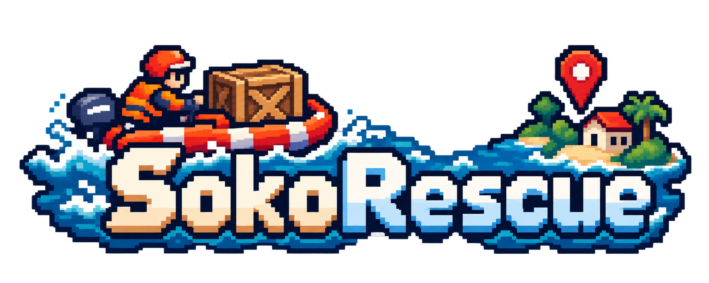
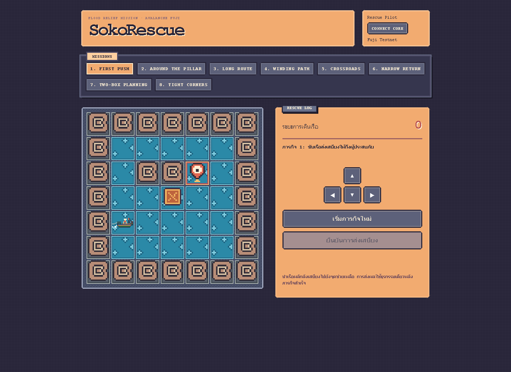

[English](README.md) | **ภาษาไทย**

<p align="center">
  
</p>

# SokoRescue

เกมพัซเซิลกู้ภัยน้ำท่วมที่ทุกก้าวมีความหมาย ขับเรือฝ่าน้ำ ดันกล่องเสบียง และนำอาหารไปส่งยังจุดช่วยเหลือให้ครบ

SokoRescue สร้างขึ้นในงาน [Team1 Thailand — Codebase Hackathon: Chula Edition](https://build.avax.network/events/b6bc9762-afc9-416d-b21e-9795750663d1) และได้รับรางวัลชนะเลิศ **Gaming Track**

**[ลองเล่นบน Vercel →](https://rescuesoko.vercel.app/)**



## เล่นยังไง?

SokoRescue คือเกม Sokoban แบบ skill-based มีทั้งหมด 8 ภารกิจ เลือกด่าน วางแผนเส้นทาง และดันกล่องอาหารไปยังจุดช่วยเหลือโดยไม่ทำกล่องติดมุม

เมื่อแก้ด่านสำเร็จ เกมจะส่งลำดับการเดินให้ smart contract บน Avalanche Fuji ตรวจซ้ำทุกก้าว ถ้าคำตอบถูกต้องจึงบันทึกคะแนนที่ดีที่สุดของผู้เล่นในด่านนั้น

หน้าเว็บจึงส่งตัวเลขคะแนนขึ้นไปเฉย ๆ ไม่ได้ เพราะคำตอบของพัซเซิลต้องผ่านการตรวจสอบบนเชนก่อน

## วิธีเล่น

### 1. เลือกภารกิจ

เริ่มจาก **First Push** หรือเลือกเล่นด่านไหนก็ได้จากทั้งหมด 8 ด่าน ช่วงท้ายจะมีทางที่แคบขึ้นและต้องวางแผนกล่องหลายใบ

### 2. ส่งเสบียง

ใช้ปุ่มลูกศรบนคีย์บอร์ดหรือปุ่มควบคุมบนหน้าจอเพื่อขับเรือ ดันกล่องอาหารให้ตรงกับ GPS rescue marker ทุกจุด ถ้ากล่องติดสามารถเริ่มภารกิจใหม่ได้ทันที

### 3. บันทึกคะแนน

เชื่อมต่อ Core Wallet บน Avalanche Fuji หลังแก้ด่านสำเร็จ ยืนยันหนึ่งธุรกรรมเพื่อส่งลำดับการเดินทั้งหมด จากนั้นเกมจะแสดงสถิติส่วนตัวและสถิติที่ดีที่สุดของด่านจาก contract

## ภารกิจ

| ภารกิจ | กล่อง | จำนวนก้าวต่ำสุดที่ตรวจสอบแล้ว |
| --- | ---: | ---: |
| First Push | 1 | 6 ก้าว |
| Around the Pillar | 1 | 15 ก้าว |
| Long Route | 1 | 23 ก้าว |
| Winding Path | 1 | 20 ก้าว |
| Crossroads | 1 | 21 ก้าว |
| Narrow Return | 1 | 21 ก้าว |
| Two-Box Planning | 2 | 41 ก้าว |
| Tight Corners | 2 | 50 ก้าว |

## รันในเครื่อง

ต้องมี Node.js และ npm

```sh
npm install
copy .env.example .env
npm run dev
```

ตั้งค่า `VITE_CONTRACT_ADDRESS` ใน `.env` เป็น address ของ `SokoChain` ที่ deploy บน Avalanche Fuji ก่อนส่งคะแนน

รันการตรวจสอบด้วย:

```sh
npm test
npm run build
```

สร้างด้วย TypeScript, Vite, viem, Solidity, Core Wallet และ Avalanche Fuji

## Credits

ด่าน 7 และ 8 ดัดแปลงจากชุดพัซเซิล Microban ของ David W. Skinner ซึ่งเผยแพร่เป็น public domain


