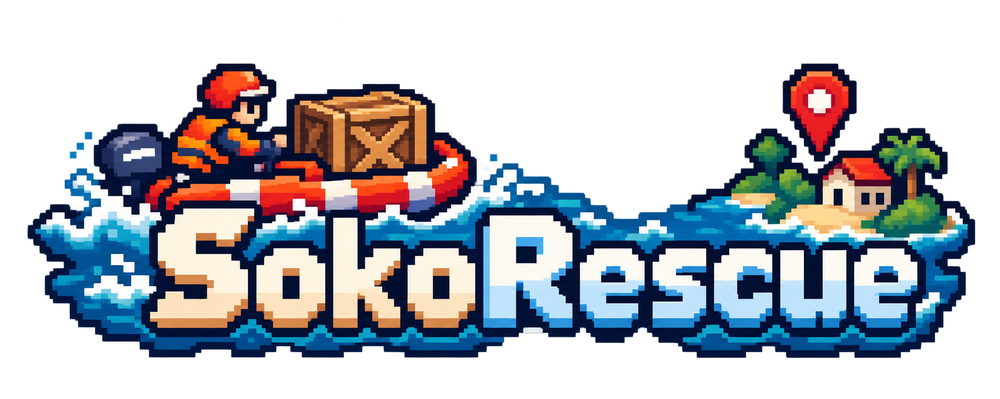
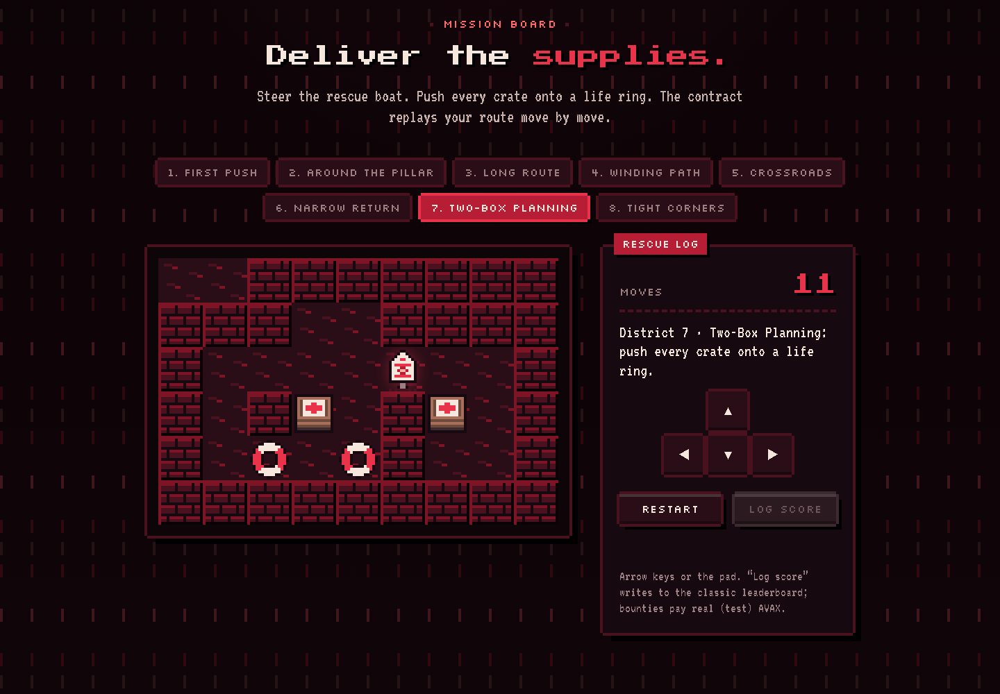

[English](README.md) | **ภาษาไทย**

<p align="center">
  
</p>

# SokoRescue

เกมพัซเซิลกู้ภัยน้ำท่วมที่ทุกก้าวมีความหมาย ขับเรือฝ่าน้ำ ดันกล่องเสบียง และนำอาหารไปส่งยังจุดช่วยเหลือให้ครบ แล้ววาง AVAX เป็นรางวัลบนพัซเซิล ให้ contract จ่ายให้คนแรกที่แก้ได้

SokoRescue สร้างขึ้นในงาน [Team1 Thailand — Codebase Hackathon: Chula Edition](https://build.avax.network/events/b6bc9762-afc9-416d-b21e-9795750663d1) และได้รับรางวัลชนะเลิศ **Gaming Track**

**[ลองเล่นบน Vercel →](https://sokorescue.vercel.app/)**



## เล่นยังไง?

SokoRescue คือเกม Sokoban แบบ skill-based มีทั้งหมด 8 ภารกิจ เลือกด่าน วางแผนเส้นทาง และดันกล่องอาหารไปยังจุดช่วยเหลือโดยไม่ทำกล่องติดมุม

เมื่อแก้ด่านสำเร็จ เกมจะส่งลำดับการเดินให้ smart contract `SokoChain` ตรวจซ้ำทุกก้าว ถ้าคำตอบถูกต้องจึงบันทึกคะแนนที่ดีที่สุดของผู้เล่นในด่านนั้น หน้าเว็บจึงส่งตัวเลขคะแนนขึ้นไปเฉย ๆ ไม่ได้ เพราะคำตอบของพัซเซิลต้องผ่านการตรวจสอบบนเชนก่อน

นอกจาก leaderboard แล้ว **Puzzle Bounty** ยังเปลี่ยนแผนที่ไหนก็ได้ให้เป็นรางวัล: ล็อก AVAX ไว้บนแผนที่ แล้วคนแรกที่พิสูจน์เส้นทางที่ถูกต้องได้จะได้รับเงินจาก contract โดยตรง

## Network

เลือก network ได้จากตัวเลือกบนแถบด้านบน (หรือเปิดเว็บด้วย `?network=fuji` / `?network=mainnet`)

| Network | Chain ID | Contract `SokoChain` |
| --- | ---: | --- |
| Avalanche Fuji (testnet) | 43113 | [`0x550389FA1204B5C4968d6C4942D4F3996940217f`](https://testnet.snowtrace.io/address/0x550389FA1204B5C4968d6C4942D4F3996940217f) |
| Avalanche C-Chain (mainnet) | 43114 | [`0x1048715d77C9532E2Ed631D09859e090cB23d01D`](https://snowtrace.io/address/0x1048715d77C9532E2Ed631D09859e090cB23d01D) |

> **Mainnet ใช้ AVAX จริง** contract ยังไม่ผ่านการ audit ควรลองทุกอย่างบน Fuji ก่อน
>
> **ข้อจำกัดที่ยังมีอยู่:** คนแรกที่ reveal คำตอบถูกต้องจะได้รางวัล ใครที่รู้คำตอบอยู่แล้ว รวมถึงผู้ตั้ง bounty ที่ใช้ wallet อีกตัว ส่ง reveal แข่งให้ขึ้น block ก่อนคุณได้ บน mainnet จึงควรตั้งรางวัลไม่สูง

## วิธีเล่น

### 1. เลือกภารกิจ

เริ่มจาก **First Push** หรือเลือกเล่นด่านไหนก็ได้จากทั้งหมด 8 ด่าน ช่วงท้ายจะมีทางที่แคบขึ้นและต้องวางแผนกล่องหลายใบ

### 2. ส่งเสบียง

ใช้ปุ่มลูกศรบนคีย์บอร์ดหรือปุ่มควบคุมบนหน้าจอเพื่อขับเรือ ดันกล่องอาหารให้ตรงกับ GPS rescue marker ทุกจุด ถ้ากล่องติดสามารถเริ่มภารกิจใหม่ได้ทันที

### 3. บันทึกคะแนน

เชื่อมต่อ Core Wallet แล้วเลือก Fuji หรือ C-Chain หลังแก้ด่านสำเร็จ ยืนยันหนึ่งธุรกรรมเพื่อส่งลำดับการเดินทั้งหมด จากนั้นเกมจะแสดงสถิติส่วนตัวและสถิติที่ดีที่สุดของด่านจาก contract

## Puzzle Bounty

### ตั้ง bounty

1. แก้แผนที่ให้ได้ด้วยตัวเองก่อน จะเป็นด่านสำเร็จรูป หรือแผนที่ของตัวเองจาก **Map workshop** ก็ได้ (ไม่เกิน 10×10 และกล่องไม่เกิน 6 ใบ)
2. ตั้งรางวัลเป็น AVAX และจำนวนชั่วโมงที่เปิดรับ แล้วยืนยันธุรกรรม AVAX จะถูกพักไว้ใน contract (escrow) และแผนที่ที่ออกแบบเองจะถูกเก็บไว้บนเชน
3. คำตอบของผู้ตั้งถูกบันทึกเป็น hash จึงไม่มีใครลอกคำตอบจาก bounty ได้

bounty บน 8 ด่านสำเร็จรูปเปิดให้ตั้งได้เฉพาะบน Fuji เพราะคำตอบของด่านเหล่านี้เป็นที่รู้กันอยู่แล้ว บน mainnet ให้ตั้ง bounty บนแผนที่ของตัวเอง

### รับรางวัล (commit-reveal)

1. **Commit** — ส่งเฉพาะ `hash(route, salt, address ของคุณ, bounty id)` ไม่มีใครอ่านหรือนำคำตอบไปใช้ซ้ำได้
2. **Reveal** — หนึ่ง block ถัดมา เปิดเผยเส้นทาง hash ผูกกับ wallet ของคุณ คนที่ลอกคำตอบจาก mempool จึงใช้ไม่ได้
3. **รับเงิน** — contract จำลองทุกก้าว ถ้าถูกต้องและ bounty ยังเปิดอยู่ AVAX ที่พักไว้จะถูกโอนให้คุณทันที

### ขอคืน bounty ที่ไม่มีใครแก้ได้

ถ้าไม่มีใครแก้ได้ก่อนหมดเวลา ผู้ตั้งขอคืนรางวัลได้โดยเปิดเผยคำตอบที่ commit ไว้ตอนสร้าง เพื่อพิสูจน์ว่าแผนที่แก้ได้จริง ถ้าคำตอบนั้นแก้แผนที่ไม่ได้ หรือไฟล์สำรองคำตอบหาย รางวัลจะถูกล็อกอยู่ใน contract ถาวร

### สำรองคำตอบ

เส้นทางและ salt ลับถูกเก็บไว้ **เฉพาะใน browser นี้** กด **Back up answers** เพื่อดาวน์โหลดไฟล์สำรอง และกด **Restore** เพื่อโหลดใน browser อื่น บน mainnet ระบบจะดาวน์โหลดไฟล์สำรองให้อัตโนมัติหลังตั้ง bounty หรือ commit ถ้าไม่มีไฟล์นี้จะ reveal หรือขอคืนเงินไม่ได้

## ภารกิจ

| ภารกิจ | กล่อง | จำนวนก้าวต่ำสุดที่ตรวจสอบแล้ว |
| --- | ---: | ---: |
| First Push | 1 | 6 ก้าว |
| Around the Pillar | 1 | 15 ก้าว |
| Long Route | 1 | 23 ก้าว |
| Winding Path | 1 | 20 ก้าว |
| Crossroads | 1 | 21 ก้าว |
| Narrow Return | 1 | 21 ก้าว |
| Two-Box Planning | 2 | 41 ก้าว |
| Tight Corners | 2 | 50 ก้าว |

## รันในเครื่อง

ต้องมี Node.js และ npm

```sh
npm install
copy .env.example .env
npm run dev
```

ตั้งค่า address ของ contract ใน `.env`:

| ตัวแปร | Network | หมายเหตุ |
| --- | --- | --- |
| `VITE_CONTRACT_ADDRESS` | Fuji | ต้องตั้งก่อนส่งคะแนนหรือใช้ bounty |
| `VITE_CONTRACT_ADDRESS_MAINNET` | C-Chain | เว้นว่างไว้เพื่อซ่อน mainnet จากตัวเลือก network |

รันการตรวจสอบด้วย:

```sh
npm test
npm run build
```

สร้างด้วย TypeScript, Vite, viem, Solidity, Core Wallet และ Avalanche

## Credits

ด่าน 7 และ 8 ดัดแปลงจากชุดพัซเซิล Microban ของ David W. Skinner ซึ่งเผยแพร่เป็น public domain
